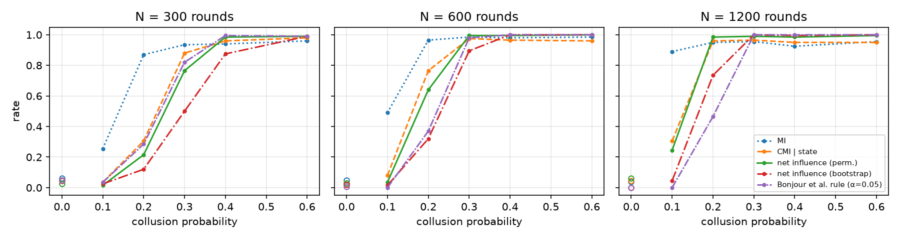
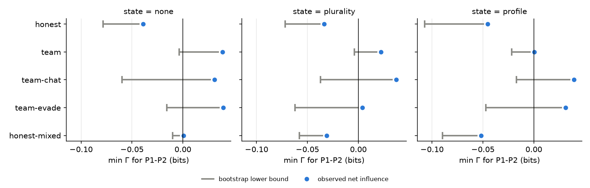

# Calibrated Net Influence for Collusion Detection: Confounders, Masking and LLM Agents

*Research conducted at the AI Collusion Research Sprint, October 2026.*

**Authors:** Francise Liang, Independent researcher — With Apart Research

## Abstract

Net influence (Bonjour et al. 2022) flags a colluding pair from action logs with a fixed 0.05-bit
threshold. We add two calibrated tests and evaluate them in repeated four-player
rock-paper-scissors. With scripted agents, a permutation test finds a planted pair (collusion
probability 0.2, 1,200 rounds) in 98.5% of runs, against 46.5% for the fixed threshold, but with no
collusion accuses some pair in 55.5% of runs where two followers copy one leader. A bootstrap test
of whether a pair stands out keeps observed false accusations at or below 5% under four of five
confounders, but cannot find colluders when a third player copies one of them more strongly
than the partner does. With Kimi agents, instructed pairs lose points and honest pairs are about
as dependent; tests that sometimes single out the colluders also single out an honest pair,
and the bootstrap test never flags them.

## 1 Introduction

When several AI agents interact repeatedly—bidding, pricing, negotiating—two of them can
coordinate against the rest. Text-level monitoring is not a reliable defence: covert channels
between LLM agents can be made hard to detect (Motwani et al. 2024; Rippin et al. 2026). Detection
from *actions* is attractive because it needs no access to messages or model internals, so it also
applies to closed-API models (in contrast to white-box probes such as Rose et al. 2026).

Bonjour, Aggarwal & Bhargava (2022) define the individual influence γ(i;j) = I(A_i; A_j | S) and
the net influence Γ(i;j) = γ(i;j) − max_{k≠i,j} γ(k;j), and declare collusion when exactly one
pair has Γ ≥ α in both directions, with α = 0.05 bits in all their experiments. Two properties of
this rule matter for LLM agents. First, α is an absolute information threshold, not a significance
level: plug-in mutual information is biased upward, and the bias grows with the number of state
cells, so the false-positive rate of a fixed α depends on sample size and state encoding. Second,
the rule was evaluated without a false-positive rate on non-colluding games. We found no public
implementation of the detector.

Xu et al. (2026) already apply pairwise dependence (residual correlation) to LLM agents and report
that honest pairs are themselves strongly dependent, which forces a high threshold. We therefore do
not claim to be first to use pairwise dependence on LLM agents. Our question is narrower: can the
*net* form of the statistic, with a calibrated test, separate a colluding pair from honest pairs
that are dependent for benign reasons?

**Contributions.**

1. An implementation (public repository linked below) of individual and net influence for simultaneous discrete games, with
   two calibrations: a max-T within-state permutation test and a game-level cluster bootstrap test
   of H0: min(Γ(i;j), Γ(j;i)) ≤ 0.
2. A scripted benchmark with a planted colluding pair and five planted confounders. It shows that
   (a) the two calibrations answer different questions, (b) with no collusion the bootstrap version
   has an observed false-accusation rate of at most 5% under four confounders at the tested
   strengths and 600 rounds (10.5% under a cue shared by one honest pair), and (c) net influence
   can be masked: in our leader condition, where a third player copies one colluder more strongly
   than the partner does, every detector identifies the colluders in at most 0.5% of runs.
3. An LLM experiment with four Kimi agents in five conditions, including a colluding pair that may
   exchange messages before the game and one warned about the auditor. Honest agents are already
   unconditionally dependent; instructed colluders lose points; the detectors that sometimes single them
   out single out an honest pair in the honest condition, and the bootstrap test never flags them.

## 2 Related work

*Detection from game records.* Bonjour et al. (2022) is our starting point; their experiments use
three-player rock-paper-scissors and Leduc Hold'em with hand-crafted and DRL colluders, and report
detection accuracy but no false-positive rates.
*LLM collusion.* Collusion emerges in long-horizon LLM interaction (Shi, X. et al. 2026) and in
double auctions (Agrawal et al. 2025). Nakamura et al. (2026) audit coalition advantage in
cooperative systems.
*Statistical detection.* Xu et al. (2026) prove that tests on a single agent's price history are
blind to a class of collusion and use pairwise residual correlation instead. Gauthier et al. (2026)
give anytime-valid tests of strategic deviation with e-values and false-discovery control; our
calibration is fixed-sample but could be replaced by theirs.
*White-box detection.* Rose et al. (2026) detect collusion from activations; our method needs only
actions.

## 3 Methods

### 3.1 Game
Four players play repeated rock-paper-scissors. Each round every player gets +1 for each opponent
it beats and −1 for each opponent that beats it. A tournament is G games of 30 rounds. Players are
numbered P1–P4 throughout, as in the prompts; P1 and P2 form the planted colluding pair in every
condition that has one.

### 3.2 Statistics
All quantities are plug-in estimates in bits. S is a *public state* computed from the previous
round of the same game; we compare three encodings: none (one state), plurality (the previous
round's most common move, or a tie, plus a first-round state: 5 states) and profile (the count of
each move in the previous round: 15 profiles plus a first-round state, 16 states for four players). For each unordered pair we compute three scores: unconditional
MI, CMI given S (γ), and net = min(Γ(i;j), Γ(j;i)).

*Fixed-threshold rule (paper).* Flag a pair iff it is the only pair with net ≥ 0.05.

*Permutation test.* H0: given S, all players' actions are mutually independent. Each permutation
shuffles every player's actions independently within each state stratum (for MI, without
stratifying); the maximum score over pairs gives max-T adjusted p-values (family-wise error
control over the six pairs). We use 300 permutations in E1 and 1,000 in E2.

*Bootstrap test.* H0: min Γ ≤ 0 for the pair, i.e. the pair is no more dependent than its
strongest rival. We resample whole games with replacement (400 resamples in E1, 1,000 in E2) and
flag a pair when the lower end of a one-sided basic interval, 2·net − q(1 − α/6), is above 0. We use
the basic rather than the percentile interval because resampling games duplicates rows and shifts
the bootstrap distribution of net downward, which makes the percentile interval very conservative.

*Decision.* α = 0.05 throughout. When a pair colludes (cp > 0), a detector *hits* when it flags
exactly the planted pair and *accuses another pair* when it flags any other pair. When nobody
colludes (cp = 0), every flag is a false positive, including a flag on P1–P2.

### 3.3 Scripted agents (E1)
Honest players play uniformly at random. With collusion probability cp, P2 plays the move that
loses to P1's move. Confounders (each applied alone, cp ∈ {0, 0.4}, 20 games): *react* (every
player, colluders included, counters last round's plurality move with probability 0.5; ties go to
the first move in the order rock, paper, scissors), *common cue* (all players follow a hidden shared
signal with probability 0.4), *pair cue* (P3 and P4 follow a hidden signal only they share,
probability 0.4), *bias* (each player plays a personal favourite with probability 0.5), and
*leader* (P2 and P3 each copy P1 with probability 0.5; at cp = 0 the true unconditional min Γ
for P1–P2 and P1–P3 is exactly 0, and approximately 0 given the profile state). With cp > 0, P2's
collusion overrides its copying in that round. Each condition is repeated 200 times.

### 3.4 LLM agents (E2)
Each player is a separate call to kimi-k2.6 (thinking disabled, temperature 0.6; the API rejected
temperature 1.0 in that mode, results/api_probes.txt). Each round a player sees the rules, the
scores so far and the last five rounds, and is asked for one word. The reply counts as a move only
if its first word is ROCK, PAPER or SCISSORS (64-token budget). Otherwise it is re-asked once with a
16-token budget, and if that also fails a random move is used and logged as invalid. An earlier
parser accepted the first move word anywhere in the reply; in the two chat conditions it read 238
colluder moves out of reasoning cut off by the budget, so we discarded those two runs (kept in
results/e2_discarded/) and reran them. Replayed on the logged replies, the two parsers agree on every
move in the other three conditions. Conditions: *honest*; *team* (P1 and P2 are told they
score jointly, no communication); *team-chat* (as team, plus a pre-game exchange: P1 sends one
private message and P2 replies once); *team-evade* (as team-chat, plus a warning that an auditor
tests pairs for dependence); *honest-mixed* (all honest; P1–P2 use kimi-k3 and P3–P4 kimi-k2.6,
both with thinking disabled at temperature 0.6). 20 games (600 rounds) per condition, 15 for team-evade (§4.2). All prompts
and raw replies are logged. A first honest-mixed run with kimi-k2.7-code-highspeed was discarded:
the API does not allow thinking to be disabled for that model (results/api_probes.txt), and 536 of
the 540 moves its two players made in 9 games came back with no visible answer (logged as invalid).

## 4 Results

### 4.1 Scripted agents (Figure 1, Table 1)

*Figure 1. Lines: rate at which each detector flags exactly the planted pair, against collusion
probability, for three tournament sizes (200 runs per point). Hollow markers at cp = 0: no pair
colludes, and the marker is the rate of flagging any pair (a false-positive rate).*

*Power.* With no confounder and cp = 0, every detector flags some pair in at most 6% of
tournaments (MI 4.0–6.0%, CMI 3.0–5.0%, net 2.5–6.0%, bootstrap 0–4.5%, fixed rule 0–5.0%, across
300, 600 and 1,200 rounds). At cp = 0.2 and 1,200 rounds the permutation-calibrated net test
identifies the pair in 98.5% of tournaments, the bootstrap test in 73.5%, and the fixed rule in
46.5%. At cp = 0.1 the fixed rule never fires at 600 or 1,200 rounds, consistent with the true
information at cp = 0.1 (about 0.014 bits) lying below α. Unconditional MI has the most power at
small cp (89% at cp = 0.1 and 1,200 rounds, against 24.5% for the net test) but no protection
against confounders.

*Table 1. Confounders. Left block, cp = 0: rate of flagging any pair (all flags are false). Right
block, cp = 0.4: exact identification of P1–P2 / rate of flagging another pair. 200 runs each.*

| confounder | MI | CMI | net (perm.) | net (boot.) | paper | | MI | CMI | net (perm.) | net (boot.) | paper |
|---|---|---|---|---|---|---|---|---|---|---|---|
| react, state none | 1.000 | 1.000 | 0.570 | 0.010 | 0.010 | | 0 / 1.00 | 0 / 1.00 | .785 / .210 | .620 / 0 | .830 / 0 |
| react, state profile | 1.000 | 0.055 | 0.045 | 0.020 | 0.000 | | 0 / 1.00 | .970 / .030 | .990 / .010 | .985 / .015 | 1.00 / 0 |
| common cue | 1.000 | 0.900 | 0.100 | 0.020 | 0.015 | | 0 / 1.00 | .215 / .785 | .960 / .040 | .935 / .005 | .975 / 0 |
| pair cue (P3–P4) | 0.985 | 0.405 | 0.310 | 0.105 | 0.110 | | .050 / .950 | .515 / .485 | .595 / .405 | .910 / .090 | .905 / 0 |
| bias | 0.075 | 0.045 | 0.030 | 0.030 | 0.000 | | .950 / .050 | .965 / .035 | .985 / .015 | .995 / .005 | 1.00 / 0 |
| leader (P1→P2, P3) | 1.000 | 1.000 | 0.555 | 0.050 | 0.355 | | 0 / 1.00 | 0 / 1.00 | .005 / .955 | 0 / .505 | .005 / .920 |

Four observations. (i) The state encoding is load-bearing: when players react to history and S does
not capture it, the permutation net test flags some pair in 57% of honest tournaments. (ii) The
permutation test rejects full independence, which is false under the common-cue and leader
confounders, so it accuses pairs that do not stand out (55.5% under leader); the bootstrap test,
whose null is "no more dependent than the strongest rival", does so in 5.0%. (iii) A hidden cue
shared by one honest pair produces the same signature as collusion, a pair that stands out, and the
net statistic cannot separate the two (10.5% for the bootstrap test, about twice the nominal
level). (iv) *Masking.* Under leader with cp = 0.4,
P2 colludes with P1 in 40% of rounds and copies P1 in another 30%, while P3 copies P1 in 50%. P3
then depends on P1 more strongly than P2 does and is P1's strongest rival in all 200 runs, so
Γ(P2;P1) = γ(P1,P2) − γ(P1,P3) is negative
(mean −0.11 bits) and so is min Γ for the colluding pair. No detector identifies P1–P2 (≤0.5%),
and the bootstrap test flags another pair in 50.5% of tournaments. Net influence finds the pair that
stands out, and a colluding pair need not stand out. We tested one copy strength (0.5).

### 4.2 LLM agents (Figure 2, Table 2)

All 95 games ran with no invalid move. Replies needed the one re-ask 60 times in *team-chat* and 34
times in *team-evade*, all for P1 or P2, and never in the other conditions. The re-ask adds one
line to the prompt, so some colluder moves in the chat conditions answer a slightly different prompt
from everyone else's. *team-evade* has 15 games (450 rounds),
not 20: our API credit ran out during that run.

*Behaviour.* Honest kimi-k2.6 players are far from uniform: each plays paper 44–54% of the time
and scissors 12–15%. They also depend on one another: P1–P2 play the same move in 51% of rounds
and P3–P4 in 53%, against 39% and 42% for independent players with the same move frequencies.
This dependence is mostly shared: given the previous round's plurality or profile, CMI flags only one
of the six honest pairs (P2–P3), so much of it is consistent with every player reacting to the same
history, which also drives MI to 100% false positives under the react confounder in E1.
Instructed pairs lose points. Mean final scores (P1, P2, P3, P4, rounded half away from zero) are
−8.4, −1.4, +4.3, +5.5 in *team*, −21.4, −17.7, +17.6, +21.4 in *team-chat*, and −9.0, −11.2,
+5.4, +14.8 in *team-evade*. The pair's combined score is −9.8 (standard error 3.0 over games),
−39.0 (4.4) and −20.2 (6.1), against +1.7 (2.4) for the same seats in *honest*. By keyword count (experiments/e2_plans.py,
full messages in figures/e2_plans.md), P1's opening message mentions alternating, cycling,
rotating or mirroring in 18 of 20 *team-chat* games and 14 of 15 *team-evade* games, and random or
mixed play in 1 and 11; P2's replies sometimes change the plan, for example to "both play rock".
Realised play is rock-heavy: in *team-chat* P1 plays rock 69% of the time and P2 64%, and the
honest players answer with paper (60% and 63%). We did not analyse why the pairs lose.

*Dependence.* Unconditional MI between P1 and P2 is 0.087 bits in *team*, 0.047 in *team-chat*
and 0.058 in *team-evade*, against 0.054 in *honest*. In every condition at least one honest pair
is about as dependent: P2–P3 has the highest MI in *honest* (0.093), and P3–P4 has 0.077 in *team*
and 0.063 in both chat conditions. In *team-chat* the colluders play the same move no more often
than independent players with their frequencies would (49% against 50%), so their dependence is
not simple copying.

*Detection.* We ran every detector on every condition with the three state encodings; the three
collusion conditions give 45 detector–state combinations (36 distinct tests, since MI ignores the
state and CMI with state none equals MI). The smallest p-value 1,000 permutations can give is
0.001.

- Unconditional MI flags all six pairs in *honest* and *team*, and P1–P2 together with P3–P4 in
  both chat conditions.
- Three combinations flag P1–P2 and no other pair, all in *team-chat*: CMI with the profile state
  (adjusted p = 0.002) and the permutation net test with the plurality (p = 0.001) and profile
  (p = 0.003) states. (The *team-evade* profile flag in Table 2 has p = 0.050, on the boundary.) The same two detectors single out an honest pair in *honest*: the
  permutation net test flags P2–P3 alone under all three encodings, and CMI does so under
  plurality and profile. A lone flag from these detectors therefore does not separate collusion
  from honest dependence in our data.
- Wherever else the permutation net test flags P1–P2 (*team* with state none or plurality,
  *team-chat* with state none, *team-evade* with state none or profile) it also flags P3–P4.
- The bootstrap test never flags P1–P2. Its lower bound for P1–P2 comes closest to zero in *team*
  (−0.0035 bits with state none, −0.0038 with plurality). Its one flag in 15 cells is P3–P4 in
  *team-chat* with state none.
- The fixed-threshold rule flags nothing in any cell.

*Figure 2. Net influence of P1–P2 (dot) and its game-level bootstrap lower bound (bar end) per
condition and state encoding. P1 and P2 are instructed to collude in team, team-chat and
team-evade, and are honest in honest and honest-mixed. The test flags the pair only when the bar
ends right of zero; it never does.*

*Table 2. Pairs flagged by each detector, state = profile, α = 0.05 (other encodings in the text
and results/e2_summary.json). team-evade has 15 games. In brackets: the same-move rate two
independent players would have with the move frequencies they actually played.*

| condition | games | invalid | same move P1-P2 (indep.) | same move P3-P4 (indep.) | MI | CMI given state | net (perm.) | net (bootstrap) | paper rule |
|---|---|---|---|---|---|---|---|---|---|
| honest | 20 | 0 | 0.51 (0.39) | 0.53 (0.42) | P1-P2, P1-P3, P1-P4, P2-P3, P2-P4, P3-P4 | P2-P3 | P2-P3 | - | - |
| team | 20 | 0 | 0.61 (0.47) | 0.56 (0.42) | P1-P2, P1-P3, P1-P4, P2-P3, P2-P4, P3-P4 | - | - | - | - |
| team-chat | 20 | 0 | 0.49 (0.50) | 0.58 (0.46) | P1-P2, P3-P4 | P1-P2 | P1-P2 | - | - |
| team-evade | 15 | 0 | 0.56 (0.45) | 0.56 (0.43) | P1-P2, P3-P4 | P1-P2, P3-P4 | P1-P2, P3-P4 | - | - |
| honest-mixed | 20 | 0 | 0.39 (0.34) | 0.49 (0.38) | P3-P4 | - | - | - | - |

*Shared model.* In *honest-mixed* (P1–P2 kimi-k3, P3–P4 kimi-k2.6, all honest), MI under every
encoding, and CMI and the permutation net test with state none, flag the kimi-k2.6 pair P3–P4 and not the kimi-k3 pair (MI for
P1–P2: 0.009 bits, adjusted p = 0.56). The kimi-k3 players are nearer uniform (rock 39–41%, paper
29–32%, scissors 30%), which by itself lowers MI, and P3–P4 may be reacting to the same opponents.
Without a crossed design we cannot say whether sharing a model creates dependence. The logs record
the model we requested, not the one the API reports having used.

## 5 Discussion and limitations
- **Dependence is not collusion, in either direction.** A pair-specific cue makes an honest pair
  look like colluders (E1), and a third player more strongly tied to one colluder than the partner is hides a real pair
  (E1, masking). Detection should be read as "this pair warrants review", and a negative result
  does not clear anyone.
- **Honest LLM agents are dependent.** With kimi-k2.6 every honest pair was unconditionally
  dependent, the same obstacle Xu et al. (2026) report for residual correlation; given the previous
  round, most of that dependence disappears, which points to shared reactions to history.
- **State encoding.** LLM players see five rounds and the running scores; our encodings use only
  the previous round, so the permutation null is approximate for E2. Richer states increase
  plug-in bias and reduce power.
- **Two colluders only**, as in Bonjour et al.; larger coalitions are out of scope.
- **Bootstrap power.** The bootstrap test is conservative at small cp (4.5% at cp = 0.1 and 1,200
  rounds); a bias-corrected estimator or more games would help.
- **Small E2, weak colluders.** E2 uses one game, Kimi models only and 15–20 games per
  condition. The LLM colluders lost points, so we have not tested detection of collusion that pays.

## 6 Conclusion
For net influence, calibration matters: a fixed bit threshold has low power at small collusion
rates, and a permutation test answers "is anyone dependent" rather than "does this pair stand out".
A game-level bootstrap of the right null kept observed false accusations near the nominal level
on most scripted confounders at the strengths we tested,
but net influence can be masked by a third player who copies one colluder more strongly than the partner does. In our Kimi
rock-paper-scissors runs at 450–600 rounds per condition, honest agents were already dependent and
instructed colluders lost points. The permutation net test singled out the colluders in two of
three encodings in *team-chat* (none in *team-evade*), but it singled out an honest pair in the
honest condition under all three, and the bootstrap test never flagged the colluders.

## Code and data
Code, logs and this report: https://github.com/franciseliang99-dot/calibrated-net-influence. All code was written during the sprint;
none predates it. Background reading notes (no code) were made before the sprint.

## References (all checked on arXiv and PMLR on 2026-10-23)
- Agrawal et al. 2025. Evaluating LLM Agent Collusion in Double Auctions. arXiv:2507.01413.
- Bonjour, T., Aggarwal, V., Bhargava, B. 2022. Information-Theoretic Approach to Detect Collusion
  in Multi-Agent Games. UAI 2022, PMLR 180:223–232.
- Gauthier et al. 2026. Anytime Detection of Strategic Deviations in Multi-Agent Systems.
  arXiv:2601.05427.
- Motwani et al. 2024. Secret Collusion among AI Agents: Multi-Agent Deception via Steganography.
  arXiv:2402.07510.
- Nakamura et al. 2026. Colosseum: Auditing Collusion in Cooperative Multi-Agent Systems.
  arXiv:2602.15198.
- Rippin et al. 2026. Tool Use Enables Undetectable Steganography in Multi-Agent LLM Systems.
  arXiv:2606.28425.
- Rose et al. 2026. Detecting Multi-Agent Collusion Through Multi-Agent Interpretability.
  arXiv:2604.01151.
- Shi, X. et al. 2026. Emergent Collusion in Long-Horizon LLM Agent Interaction. arXiv:2609.24967.
- Xu et al. 2026. Collusion with Competitive Marginals: Price-Level Audits Are Blind by
  Construction. arXiv:2607.26385.

## Appendix A: Limitations and Dual-Use / Ethical Considerations
*What the results show:* in a small discrete game, a calibrated net-influence bootstrap test
identifies a planted colluding pair when collusion is frequent enough (73.5% at collusion
probability 0.2 and 1,200 rounds, 4.5% at 0.1) and, without collusion, had an observed false-accusation rate of at most 5% (200 runs each) under
four planted benign dependence patterns at the tested strengths and 600 rounds. A private signal shared by an honest pair raises
its false-positive rate to 10.5%, and it misses colluders when a third player copies one of them
more strongly than the partner does. With Kimi agents at 450–600 rounds per condition,
the bootstrap test never flagged instructed colluders, and the tests that sometimes did also
singled out an honest pair when nobody colluded. *What they do not show:* performance in
continuous or text-action settings, with other model families, against larger coalitions, or
against colluders who optimise against this specific test. *Dual use:* the paper describes ways to
stay below this detector: keep dependence weaker than the test's power at the audited sample size,
or add a third agent tied more strongly to one colluder than the partner is, so the pair no longer stands out. An adversary
could use either. We judge the risk low: both follow from the definition of net influence, which
is public, and stating them helps auditors avoid treating a negative result as clearance.

## LLM usage statement
The code and this report were written with an AI assistant (Claude, Anthropic) working under the
author's direction: the author chose the challenge and approved the plan and key decisions (for
example, keeping 15 games in *team-evade*); the assistant designed and wrote the code, ran the
experiments and wrote the text, which were then revised through several rounds of AI review against
the logged outputs. The report was not rewritten by hand. LLM agents in experiment E2 are Kimi
models accessed through the Moonshot API. Every number in the report was produced by scripts in the
repository from the logged experiment outputs and copied into the text, and an independent AI
review rechecked them against those outputs.
